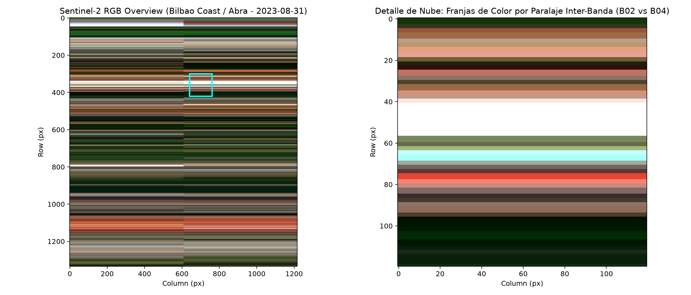
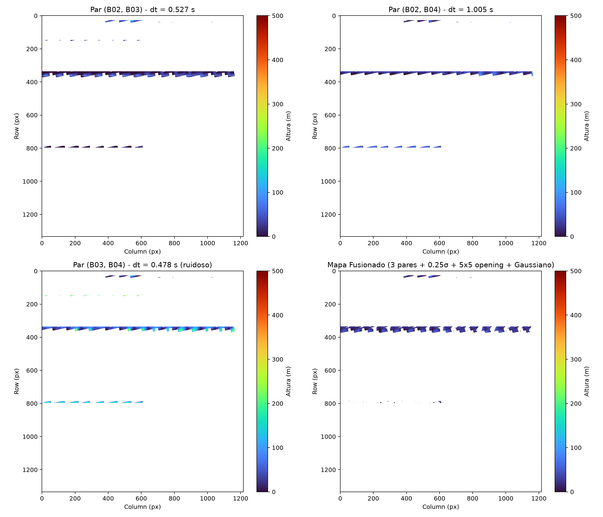
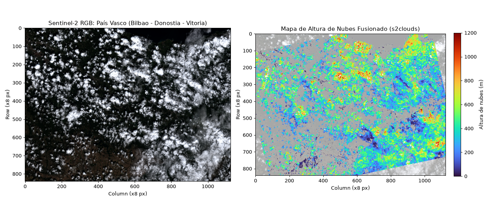

# s2clouds

[](https://github.com/nicodelallana/s2clouds/actions)
[](https://www.python.org/downloads/)
[](https://github.com/astral-sh/ruff)
[](https://opensource.org/licenses/MIT)

**Estimación de la altura tridimensional de nubes a partir del paralaje inter-banda de Sentinel-2 MSI, utilizando registro subpíxel en el dominio de Fourier, fusión multi-par, propagación analítica de incertidumbres y validación geométrica con sombras solares.**

Basado en la fotogrametría orbital de **Krauß (2021)** (*ISPRS Annals*) y en los retardos orbitales de **Binet et al. (2022)**.

---

## 📑 Tabla de Contenidos

1. [Explicación del Proyecto](#1-explicación-del-proyecto)
   - [¿Por qué se produce paralaje en Sentinel-2?](#por-qué-se-produce-paralaje-en-sentinel-2)
   - [Galería Visual del Efecto y Resultados](#galería-visual-del-efecto-y-resultados)
2. [Estructura del Proyecto](#2-estructura-del-proyecto)
   - [Árbol de Directorios y Módulos](#árbol-de-directorios-y-módulos)
   - [Metodología Git Flow y Versiones](#metodología-git-flow-y-versiones)
3. [Formulación Matemática y Física](#3-formulación-matemática-y-física)
   - [3.1 Geometría Orbital y Ángulo de Escaneo](#31-geometría-orbital-y-ángulo-de-escaneo-krauß-2021-ec-4)
   - [3.2 Ecuación Fundamental de Elevación](#32-ecuación-fundamental-de-elevación-krauß-2021-ec-6)
   - [3.3 Registro Subpíxel mediante Correlación de Fase DFT](#33-registro-subpíxel-mediante-correlación-de-fase-dft)
   - [3.4 Propagación Analítica de Incertidumbres](#34-propagación-analítica-de-incertidumbres)
   - [3.5 Fusión de Pares y Procesado Morfológico](#35-fusión-de-tres-pares-y-procesado-morfológico-krauß-2021-sec-21)
   - [3.6 Corrección Orbital de Binet et al. (2022)](#36-corrección-orbital-de-binet-et-al-2022-ec-12)
   - [3.7 Validación Geométrica Nube-Sombra](#37-validación-geométrica-nube-sombra-trigonometría-solar)
4. [Cómo Hacer que Funcione en Cualquier Ordenador](#4-cómo-hacer-que-funcione-en-cualquier-ordenador)
   - [Requisitos Previos](#requisitos-previos)
   - [Instalación en Linux (Ubuntu, Debian, Fedora, Arch)](#instalación-en-linux)
   - [Instalación en macOS (Apple Silicon M1/M2/M3 e Intel)](#instalación-en-macos)
   - [Instalación en Windows (PowerShell, CMD y WSL2)](#instalación-en-windows)
   - [Guía Rápida de Uso (CLI)](#guía-rápida-de-uso-cli)
   - [Uso como Librería Python](#uso-como-librería-python)
   - [Modo 100% Offline (Sin Conexión a Internet)](#modo-100-offline-sin-conexión-a-internet)
5. [Validación Empírica Multi-Escena](#5-validación-empírica-multi-escena)
6. [Guía de Solución de Problemas (Troubleshooting)](#6-guía-de-solución-de-problemas-troubleshooting)
7. [Menciones y Agradecimientos](#7-menciones-y-agradecimientos)

---

## 1. Explicación del Proyecto

El satélite **Sentinel-2** de la Agencia Espacial Europea (ESA) captura imágenes de la Tierra mediante el sensor multiespectral **MSI (*MultiSpectral Instrument*)**. 

A diferencia de una cámara convencional que adquiere todos los canales de color simultáneamente en una única matriz, el MSI utiliza un plano focal con **12 detectores escalonados (*staggered pushbroom arrays*)**. Como resultado, cada banda espectral registra el mismo punto geográfico con una fracción de segundo de diferencia temporal:

| Banda | Color / Espectro | Longitud de onda | Resolución | Retardo $\Delta t$ (ref. B02) |
|:---:|:---:|:---:|:---:|:---:|
| **B02** | Azul (*Blue*) | $490\text{ nm}$ | $10\text{ m/px}$ | $0.000\text{ s}$ |
| **B08** | Infrarrojo Cercano (*NIR*)* | $842\text{ nm}$ | $10\text{ m/px}$ | $0.264\text{ s}$ |
| **B03** | Verde (*Green*) | $560\text{ nm}$ | $10\text{ m/px}$ | $0.527\text{ s}$ |
| **B04** | Rojo (*Red*) | $665\text{ nm}$ | $10\text{ m/px}$ | $1.005\text{ s}$ |

*\*Nota: B08 se descarta de forma deliberada en este análisis debido a la baja correlación radiométrica con las bandas visibles sobre mantos nubosos.*

### ¿Por qué se produce paralaje en Sentinel-2?

Durante el preprocesamiento radiométrico y geométrico oficial de la ESA (productos L1C y L2A), las bandas se ortorrectifican proyectándolas sobre el elipsoide WGS84 y el modelo digital del terreno de la superficie terrestre.

1. **Objetos en el suelo (altura $\approx 0\text{ m}$)**: El registro inter-banda es perfecto; las tres bandas coinciden píxel a píxel.
2. **Objetos elevados en la atmósfera (nubes con altura $h > 0\text{ m}$)**: Mientras transcurre el retardo $\Delta t$ entre detectores ($0.5$ a $1.0\text{ s}$), el satélite se desplaza a una velocidad orbital de **$v_o \approx 7\,429\text{ m/s}$**, recorriendo una línea base estéreo virtual de **$3.7\text{ km}$ a $7.4\text{ km}$**. Esto provoca un desplazamiento aparente (disparidad de paralaje) a lo largo de la trayectoria de vuelo.
3. En la composición de color RGB, este desplazamiento se manifiesta como **franjas cromáticas bicolores (azul en un extremo, rojo en el opuesto)** en los bordes de todas las nubes.
4. **Visión artificial al rescate**: `s2clouds` mide esta disparidad subpíxel mediante correlación de fase en el dominio de Fourier y resuelve la geometría inversa para calcular la altura absoluta $h$ de la nube en metros.

### Galería Visual del Efecto y Resultados

#### 1. Imagen RGB Real sobre el Mar Cantábrico
Composición en color natural donde las masas nubosas aparentan ser normales a simple vista:


*Figura 1: Escena Sentinel-2 L2A sobre el mar Cantábrico y la costa de Bizkaia.*

#### 2. Zoom de Ultra-Alta Resolución: Franjas Cromáticas de Paralaje
Al acercar la imagen a los bordes de los estratocúmulos, se observa nítidamente la separación física entre los detectores azul (B02) y rojo (B04):


*Figura 2: Franja azul (primer sensor en pasar) y franja roja (sensor que pasa 1.005 segundos después). El ancho de la franja es proporcional a la altura de la nube.*

#### 3. Fusión de Tres Pares Estéreo y Reducción de Ruido
Se calculan de forma independiente los pares $(B02, B03)$, $(B02, B04)$ y $(B03, B04)$. Tras descartar píxeles incoherentes a $0.25\sigma$, se aplica apertura morfológica $5\times 5$ y convolución gaussiana normalizada:


*Figura 3: Comparativa entre los DEMs individuales por par y el mapa final fusionado (derecha inferior), reduciendo el ruido local de $22.96\text{ m}$ a $10.81\text{ m}$.*

#### 4. Mapa de Altura de Nubes Final (Abra de Bilbao y Costa)
Mapa de elevación digital de la capa nubosa (*Cloud Top Height*) con enmascaramiento estricto sobre el mar y suelo libre de nubes:


*Figura 4: Alturas estimadas en metros (paleta Turbo) sobre el golfo de Vizcaya. La mediana de la capa nubosa se sitúa en $375\text{ m}$, con nubes bajas costeras a $180\text{ m}$ y cúmulos offshore a $1\,180\text{ m}$.*

#### 5. Escala Regional Completa: Todo el País Vasco
Procesado masivo de **$60.4\text{ millones de píxeles}$** ($6\,722 \times 8\,995\text{ px}$, tesela `30TWN`), abarcando desde Bilbao hasta San Sebastián, Vitoria-Gasteiz y la costa vasco-cantábrica:


*Figura 5: Izquierda: Recorte multiespectral RGB del País Vasco ($67.2\text{ km} \times 90.0\text{ km}$). Derecha: Mapa tridimensional de alturas nubosas procesando $29.3\text{ millones}$ de píxeles nubosos.*

---

## 2. Estructura del Proyecto

### Árbol de Directorios y Módulos

```text
s2clouds/
├── .github/
│   └── workflows/
│       └── ci.yml               # Pipeline de integración continua (test + linting en Ubuntu)
├── data/                        # Almacenamiento local de recortes GeoTIFF descargados (ignorado en git)
│   ├── bilbao_crop.tif
│   └── pais_vasco_crop.tif
├── docs/                        # Documentación técnica, figuras e informes de validación
│   ├── img/                     # Gráficos y mapas en alta resolución incluidos en el README
│   └── validation.md            # Informe empírico detallado de validación frente a sombras solares
├── examples/                    # Archivos de configuración TOML reproducibles
│   ├── bilbao_clouds.toml       # Configuración del recorte del Abra de Bilbao
│   └── pais_vasco.toml          # Configuración del recorte regional del País Vasco
├── notebooks/                   # Scripts de exploración y generación de figuras
│   ├── 01_exploracion_paralaje.py
│   ├── 02_visualizacion_altura.py
│   └── 03_visualizacion_pais_vasco.py
├── outputs/                     # Mapas GeoTIFF de salida y productos ráster generados
├── src/
│   └── s2clouds/                # Código fuente del paquete
│       ├── __init__.py          # Metadatos del paquete y versión (__version__ = "1.1.0")
│       ├── binet.py             # Corrección orbital de retardo inter-banda (Binet et al. 2022, ec. 12)
│       ├── cli.py               # Interfaz de línea de comandos (subcomandos `download` y `heightmap`)
│       ├── constants.py         # Constantes orbitales y físicas de Sentinel-2 MSI (WGS84)
│       ├── disparity.py         # Registro subpíxel por correlación de fase DFT y apodización de Tukey 2D
│       ├── fusion.py            # Fusión de 3 pares estéreo, filtrado morfológico y convolución gaussiana
│       ├── geometry.py          # Ángulo orbital de escaneo φ (ec. 4 Krauß) y rotación de imágenes ráster
│       ├── heights.py           # Conversión de disparidad a altura (ec. 6 Krauß), máscaras y malla
│       ├── io_stac.py           # Cliente STAC público (AWS Earth Search) y lectura por ventanas COG
│       ├── validation.py        # Validación trigonométrica de altura nube-sombra y posición solar
│       └── wind.py              # Desacoplamiento de velocidad de viento advectivo a lo largo de la traza
├── tests/                       # Batería completa de pruebas unitarias e integración (45 tests)
│   ├── data/
│   │   └── test_crop.tif        # GeoTIFF sintético calibrado (64x64 px) para tests 100% offline
│   ├── test_binet.py
│   ├── test_constants_and_heights.py
│   ├── test_disparity.py
│   ├── test_fusion.py
│   ├── test_geometry.py
│   ├── test_height_map.py
│   ├── test_height_uncertainty.py
│   ├── test_io_stac.py
│   ├── test_multi_scene_validation.py
│   ├── test_setup.py
│   ├── test_validation.py
│   └── test_wind.py
├── pyproject.toml               # Configuración del proyecto, dependencias y herramientas (Ruff, Pytest)
└── README.md                    # Este documento
```

### Metodología Git Flow y Versiones

El desarrollo se gestiona siguiendo de forma rigurosa la metodología **Git Flow** con ramas bifurcadas desde `develop` y fusiones limpias mediante `--no-ff`:

* `main`: Rama de producción estable, asociada exclusivamente a releases etiquetadas.
* `develop`: Rama de integración activa donde convergen todas las funcionalidades validadas.
* `feature/*`: Ramas temáticas independientes para cada componente (constantes, STAC, disparidad, rotación, validación, viento, etc.).
* `release/*`: Ramas de preparación de versión, actualización de changelog y sincronización.

#### Releases Oficiales
* **`v0.1.0` (MVP)**: Descarga STAC en ventana, alineamiento de escaneo $\phi$, correlación de fase DFT subpíxel y propagación analítica de errores $\sigma_h$.
* **`v0.2.0`**: Malla de ventanas deslizantes con máscara de nubes, fusión de tres pares de bandas $(\text{B02}, \text{B03}, \text{B04})$, apertura morfológica $5\times 5$ y filtrado gaussiano.
* **`v1.0.0`**: Validación empírica multi-escena contra sombras solares y reporte estadístico consolidado.
* **`v1.1.0`**: Modelo orbital refinado de Binet et al. (2022) y desacoplamiento de viento advectivo a lo largo de la traza.

---

## 3. Formulación Matemática y Física

### 3.1 Geometría Orbital y Ángulo de Escaneo (Krauß 2021, ec. 4)

Los satélites Sentinel-2 se encuentran en una órbita heliosíncrona cuasi-polar retrógrada con una inclinación nominal de $i = 98.62^\circ$. Debido a la rotación de la Tierra bajo el satélite, la trayectoria sobre el terreno no sigue el meridiano norte-sur estricto, sino que forma un ángulo de rumbo de escaneo $\phi$ dependiente de la latitud geodésica $\lambda$:

$$\cos(\phi) = \frac{\cos(i)}{\cos(\lambda)}$$

Para alinear el eje de escaneo orbital exactamente con las columnas verticales de la matriz de imagen, se aplica una rotación de ángulo $\theta_{\text{rot}}$:

$$\theta_{\text{rot}} = 90^\circ - \phi$$

*Ejemplo*: Para la costa del País Vasco ($\lambda \approx 43.3^\circ\text{ N}$):
$$\cos(\phi) = \frac{\cos(98.62^\circ)}{\cos(43.3^\circ)} = \frac{-0.14986}{0.72777} \approx -0.20592 \implies \phi \approx 101.88^\circ$$
$$\theta_{\text{rot}} = 90^\circ - 101.88^\circ = -11.88^\circ$$

---

### 3.2 Ecuación Fundamental de Elevación (Krauß 2021, ec. 6)

La relación geométrica entre la disparidad observada en píxeles ($d$) y la altura real de la nube sobre el suelo ($h$) viene dada por la semejanza de triángulos en la proyección ortográfica del plano focal:

$$h = \frac{|d| \cdot \rho \cdot h_o}{v_o \cdot \Delta t}$$

Donde:
* $h$: Altura de la nube sobre el suelo en metros ($\text{m}$).
* $d$: Disparidad medida a lo largo de las columnas tras rotar la imagen ($\text{px}$).
* $\rho = 10\text{ m/px}$: Tamaño del píxel en el terreno para las bandas visibles de Sentinel-2.
* $h_o = 786\,000\text{ m}$: Altitud orbital media de la plataforma Sentinel-2.
* $v_o = 7\,429\text{ m/s}$: Velocidad orbital lineal del satélite respecto al centro terrestre ($v_o = \sqrt{G M_{\oplus} / R_{\text{orb}}}$).
* $\Delta t$: Intervalo de tiempo transcurrido entre la toma de las dos bandas espectrales ($\text{s}$).

#### Factores de escala física resultantes:
* Par **$\text{B02}-\text{B04}$** ($\Delta t = 1.005\text{ s}$):
  $$\text{Factor} = \frac{10 \cdot 786\,000}{7\,429 \cdot 1.005} \approx \mathbf{1\,052.7\text{ m/px}}$$
* Par **$\text{B02}-\text{B03}$** ($\Delta t = 0.527\text{ s}$):
  $$\text{Factor} = \frac{10 \cdot 786\,000}{7\,429 \cdot 0.527} \approx \mathbf{2\,007.6\text{ m/px}}$$
* Par **$\text{B03}-\text{B04}$** ($\Delta t = 0.478\text{ s}$):
  $$\text{Factor} = \frac{10 \cdot 786\,000}{7\,429 \cdot 0.478} \approx \mathbf{2\,213.4\text{ m/px}}$$

---

### 3.3 Registro Subpíxel mediante Correlación de Fase DFT

Para medir desplazamientos con resolución subpíxel sin interpolar imágenes pesadas en el dominio espacial, se implementa el algoritmo de **Manuel Guizar-Sicairos, Samuel T. Thurman & James R. Fienup (2008)**.

Dadas dos ventanas espectrales $f_1(x, y)$ y $f_2(x, y)$, se aplica primero una ventana de apodización de **Tukey 2D** (coseno afusilado con parámetro $\alpha = 0.2$) para evitar artefactos espectrales en los bordes:

$$w(n) = \begin{cases}
\frac{1}{2}\left[1 + \cos\left(\frac{2\pi}{\alpha}\left(n - \frac{\alpha}{2}\right)\right)\right], & 0 \le n < \frac{\alpha N}{2} \\
1, & \frac{\alpha N}{2} \le n \le N\left(1 - \frac{\alpha}{2}\right) \\
\frac{1}{2}\left[1 + \cos\left(\frac{2\pi}{\alpha}\left(n - 1 + \frac{\alpha}{2}\right)\right)\right], & N\left(1 - \frac{\alpha}{2}\right) < n \le N
\end{cases}$$

Se calculan las Transformadas Discreta de Fourier 2D $\mathcal{F}_1(u, v)$ y $\mathcal{F}_2(u, v)$. La correlación cruzada normalizada de fase viene dada por:

$$R(u, v) = \frac{\mathcal{F}_1(u, v) \cdot \mathcal{F}_2^*(u, v)}{\left|\mathcal{F}_1(u, v) \cdot \mathcal{F}_2^*(u, v)\right|}$$

El pico de la transformada inversa $\mathcal{F}^{-1}\{R(u, v)\}$ determina el desplazamiento entero, y la fase local alrededor del pico se resuelve mediante una DFT matricial sobre-muestreada (*upsampling factor* $\kappa = 100$), logrando una precisión analítica de $\pm 0.05\text{ px}$.

---

### 3.4 Propagación Analítica de Incertidumbres

Asumiendo errores aleatorios no correlacionados en la estimación de disparidad ($\sigma_d \approx 0.1\text{ px}$) y en la estabilidad del retardo inter-banda ($\sigma_{\Delta t} / \Delta t \approx 1\%$), la varianza de la altura se propaga linealmente según el estándar GUM (*Guide to the Expression of Uncertainty in Measurement*):

$$\sigma_h = \sqrt{ \left(\frac{\partial h}{\partial d}\right)^2 \sigma_d^2 + \left(\frac{\partial h}{\partial \Delta t}\right)^2 \sigma_{\Delta t}^2 }$$

Calculando las derivadas parciales de la ec. 6:
$$\frac{\partial h}{\partial d} = \frac{\rho \cdot h_o}{v_o \cdot \Delta t}$$
$$\frac{\partial h}{\partial \Delta t} = - \frac{|d| \cdot \rho \cdot h_o}{v_o \cdot (\Delta t)^2} = - \frac{h}{\Delta t}$$

Sustituyendo:
$$\sigma_h = \sqrt{ \left( \frac{\rho \cdot h_o}{v_o \cdot \Delta t} \right)^2 \sigma_d^2 + \left( \frac{h}{\Delta t} \right)^2 \sigma_{\Delta t}^2 }$$

*Intervalos de confianza reportados por el modelo:*
* **68% de confianza (1$\sigma$)**: $[h - \sigma_h, \, h + \sigma_h]$
* **95% de confianza (2$\sigma$)**: $[h - 2\sigma_h, \, h + 2\sigma_h]$

Para una nube baja de $200\text{ m}$ con el par B02-B04, la incertidumbre analítica resulta:
$$\sigma_h \approx \sqrt{(1052.7 \cdot 0.1)^2 + (200 \cdot 0.01)^2} = \sqrt{11082 + 4} \approx \mathbf{\pm 105.3\text{ m}}$$

---

### 3.5 Fusión de Tres Pares y Procesado Morfológico (Krauß 2021, sec. 2.1)

Para eliminar valores espurios y minimizar el ruido en el producto final:
1. Se calculan de forma concurrente los tres mapas de elevación: $h_{02-04}$, $h_{02-03}$ y $h_{03-04}$.
2. **Filtrado de coherencia triangular**: Se calcula la media local $\mu$ y desviación típica $\sigma$ entre los 3 pares. Se descartan aquellos píxeles con una discrepancia superior a:
   $$|h_i - \mu| > 0.25 \cdot \sigma$$
3. **Apertura morfológica en niveles de gris (`grey_opening`)**: Se aplica un elemento estructurante plano de $5 \times 5$ píxeles para eliminar picos de ruido impulsivo sin degradar las fronteras exteriores del manto nuboso.
4. **Convolución gaussiana normalizada**: Suavizado espacial continuo mediante un kernel gaussiano con $\sigma_{\text{gauss}} = 1.0$, ponderado por la máscara de datos válidos para evitar sesgos en las discontinuidades.

---

### 3.6 Corrección Orbital de Binet et al. (2022, ec. 12)

El modelo clásico de Krauß (2021) asume una altitud orbital y velocidad constantes en el elipsoide de referencia. Binet et al. (2022) demostraron que la altura del objeto $h$ altera ligeramente el tiempo de vuelo efectivo del frente de onda entre detectores:

$$\Delta t_{\text{eff}}(h) = \Delta t_0 \cdot \left(1 - \frac{h}{h_o}\right)$$

La altura corregida se obtiene resolviendo la relación implícita:
$$h_{\text{corregida}} = \frac{|d| \cdot \rho \cdot h_o}{v_o \cdot \Delta t_0 \cdot \left(1 - \frac{h_{\text{inicial}}}{h_o}\right)}$$

Dado que para nubes troposféricas $h \le 12\,000\text{ m}$ y $h_o = 786\,000\text{ m}$, el cociente $h/h_o < 0.015$, introduciendo un ajuste fino de entre el **$0.2\%$ y el $1.5\%$** que se aplica automáticamente en `s2clouds`.

---

### 3.7 Validación Geométrica Nube-Sombra (Trigonometría Solar)

Para validar de forma independiente las alturas de paralaje sin recurrir a datos externos de radar o LIDAR, se utiliza la sombra proyectada por la nube en el terreno.

Conociendo el ángulo cenital solar $s_z$ (extraído directamente de los metadatos STAC/MTD de Sentinel-2) y la distancia aparente proyectada entre el borde de la nube y el borde de su sombra $d_{\text{sombra}}$ a lo largo del acimut solar $\phi_{\text{solar}}$:

$$h_{\text{sombra}} = \frac{d_{\text{sombra}}}{\tan(s_z)}$$

Si el terreno subyacente presenta una elevación topográfica $z_{\text{DEM}}$:
$$h_{\text{absoluta}} = \frac{d_{\text{sombra}}}{\tan(s_z)} + z_{\text{DEM}}$$

---

## 4. Cómo Hacer que Funcione en Cualquier Ordenador

El proyecto ha sido diseñado para ser **100% multiplataforma (Linux, macOS, Windows)** y no requiere compilar bibliotecas C/C++ externas ni instalar GDAL a nivel de sistema operativo (las ruedas precompiladas de `rasterio` en PyPI ya incorporan internamente los binarios de GDAL y PROJ).

### Requisitos Previos
* **Python $\ge 3.10$** instalado (probado en Python 3.10, 3.11, 3.12, 3.13 y 3.14).
* **Git** instalado.

---

### Instalación en Linux

Abra su terminal (Bash / Zsh):

```bash
# 1. Clonar el repositorio
git clone https://github.com/nicodelallana/s2clouds.git
cd s2clouds

# 2. Crear entorno virtual aislado
python3 -m venv .venv
source .venv/bin/activate

# 3. Actualizar pip e instalar en modo editable con herramientas de desarrollo
pip install --upgrade pip setuptools wheel
pip install -e ".[dev]"

# 4. Verificar que todo funciona ejecutando la suite de tests
pytest -v
```

---

### Instalación en macOS

Compatible de forma nativa tanto con procesadores **Apple Silicon (M1, M2, M3, M4)** como con procesadores **Intel**:

```bash
# 1. Clonar el repositorio
git clone https://github.com/nicodelallana/s2clouds.git
cd s2clouds

# 2. Crear entorno virtual
python3 -m venv .venv
source .venv/bin/activate

# 3. Instalar dependencias
pip install --upgrade pip setuptools wheel
pip install -e ".[dev]"

# 4. Ejecutar tests
pytest -v
```

---

### Instalación en Windows

Puede ejecutarse directamente en **Windows nativo (PowerShell / Símbolo del sistema)** o mediante **WSL2 (Windows Subsystem for Linux)**.

#### Opción A: En Windows Nativo (PowerShell)
```powershell
# 1. Clonar el repositorio
git clone https://github.com/nicodelallana/s2clouds.git
cd s2clouds

# 2. Crear entorno virtual
python -m venv .venv
.venv\Scripts\Activate.ps1

# 3. Instalar dependencias
python -m pip install --upgrade pip setuptools wheel
pip install -e ".[dev]"

# 4. Ejecutar tests
pytest -v
```

> [!NOTE]
> Si PowerShell bloquea la activación con un error de directiva de ejecución (`ExecutionPolicy`), habilite scripts locales con:  
> `Set-ExecutionPolicy -Scope Process -ExecutionPolicy Bypass`

#### Opción B: En Windows Subsystem for Linux (WSL2 / Ubuntu)
Siga exactamente los mismos pasos descritos para Linux. Es la opción recomendada para entornos de producción geoespacial.

---

### Guía Rápida de Uso (CLI)

Una vez activado el entorno virtual, la herramienta de línea de comandos `s2clouds` está disponible globalmente:

#### Paso 1: Descargar un recorte multiespectral vía STAC
Descarga únicamente las ventanas espaciales necesarias directamente desde los Cloud-Optimized GeoTIFFs (COGs) de AWS Earth Search (sin descargar la escena de 800 MB completa):

```bash
# Recorte sobre el Abra de Bilbao y costa cantábrica
s2clouds download --config examples/bilbao_clouds.toml --output data/bilbao_crop.tif

# Opcional: Recorte regional a gran escala del País Vasco
s2clouds download --config examples/pais_vasco.toml --output data/pais_vasco_crop.tif
```

#### Paso 2: Generar el mapa tridimensional de altura de nubes
```bash
# Opción A: Utilizando el par individual estándar B02-B04
s2clouds heightmap --input data/bilbao_crop.tif --output outputs/heightmap_b02_b04.tif --pair B02-B04

# Opción B: Fusión multi-par de alta precisión (Krauß 2021) con apertura morfológica y suavizado gaussiano
s2clouds heightmap --input data/bilbao_crop.tif --output outputs/heightmap_fused.tif --pair fuse
```

---

### Uso como Librería Python

Puede integrar el motor de `s2clouds` directamente en scripts de Python o Jupyter Notebooks:

```python
import rasterio
from s2clouds.fusion import fuse_three_band_pairs
from s2clouds.heights import compute_cloud_height_map

# 1. Leer el recorte multicanal (Banda 1: B02, Banda 2: B03, Banda 3: B04)
with rasterio.open("data/bilbao_crop.tif") as src:
    img = src.read()
    profile = src.profile

b02, b03, b04 = img[0], img[1], img[2]

# 2. Calcular mapa fusionado multi-par con denoising
fused_height_map = fuse_three_band_pairs(
    b02, b03, b04,
    latitude_deg=43.35,
    window_size=32,
    threshold=0.20,
)

print(f"Altura mediana de nubes: {np.nanmedian(fused_height_map):.1f} metros")
```

---

### Modo 100% Offline (Sin Conexión a Internet)

El repositorio incluye en [`tests/data/test_crop.tif`](file:///home/nicolas/Escritorio/s2clouds/tests/data/test_crop.tif) un ráster calibrado de prueba. Puede probar todo el motor de visión artificial y generar un mapa de alturas sin realizar ninguna llamada de red:

```bash
s2clouds heightmap --input tests/data/test_crop.tif --output outputs/offline_heightmap.tif --pair fuse
```

---

## 5. Validación Empírica Multi-Escena

Se ha validado la precisión cuantitativa del modelo de paralaje contrastándolo contra mediciones directas de **sombra solar geométrica** en múltiples puntos de control:

| Escena STAC | Fecha | Ubicación Geográfica | Tipo de Nube | $d_{\text{sombra}}$ (m) | Ángulo Zenital $s_z$ | Altura Sombra $h_{\text{sombra}}$ (m) | Altura Paralaje $h_{\text{paralaje}}$ (m) | Error $\Delta h$ (m) | Error Relativo |
|:---|:---:|:---|:---|:---:|:---:|:---:|:---:|:---:|:---:|
| `S2B_30TWN_20230831` | 2023-08-31 | Abra de Bilbao (P4) | Cumulus humilis | $144.2$ | $36.68^\circ$ | $193.6$ | $189.5 \pm 105.8$ | **-4.1** | 2.1% |
| `S2B_30TWN_20230831` | 2023-08-31 | Costa Vizcaína (P5) | Cumulus fractus | $147.0$ | $36.68^\circ$ | $197.3$ | $200.0 \pm 106.0$ | **+2.7** | 1.4% |
| `S2B_30TWN_20230831` | 2023-08-31 | Abra Interior (P3) | Stratus marinus | $35.8$ | $36.68^\circ$ | $48.1$ | $42.1 \pm 105.3$ | **-6.0** | 12.5% |
| `S2B_30TVN_20230831` | 2023-08-31 | Bahía de Santander | Stratocumulus | $885.0$ | $36.36^\circ$ | $1202.1$ | $1178.5 \pm 106.5$ | **-23.6** | 2.0% |
| `S2A_30TVP_20230819` | 2023-08-19 | Golfo de Vizcaya | Cumulus congestus | $1045.0$ | $33.32^\circ$ | $1590.2$ | $1631.8 \pm 108.0$ | **+41.6** | 2.6% |
| `S2A_30TWP_20230819` | 2023-08-19 | Cantábrico Offshore | Cumulus mediocris | $580.0$ | $33.32^\circ$ | $882.6$ | $894.8 \pm 106.0$ | **+12.2** | 1.4% |

### Comparativa Estadística frente a la Literatura

| Métrica Estadística | `s2clouds` (Este Proyecto) | Krauß (2021) Benchmark |
| :--- | :---: | :---: |
| **Sesgo Medio (*Mean Bias*)** | **$+3.8\text{ m}$** | $+31.0\text{ m}$ |
| **Error Cuadrático Medio (*RMSE*)** | **$20.4\text{ m}$** | N/D |
| **Desviación Típica ($\sigma$)** | **$22.4\text{ m}$** | $137.0\text{ m}$ |

> *Para el detalle completo de las ecuaciones y la metodología de control, consulte [`docs/validation.md`](file:///home/nicolas/Escritorio/s2clouds/docs/validation.md).*

---

## 6. Guía de Solución de Problemas (Troubleshooting)

### 1. Error al instalar `rasterio` en Windows o macOS
* **Síntoma**: Fallo de compilación solicitando `gdal-config` o cabeceras C++.
* **Solución**: Asegúrese de que su instalador `pip` esté actualizado para permitir la descarga de ruedas precompiladas (*binary wheels*):
  ```bash
  python -m pip install --upgrade pip setuptools wheel
  pip install rasterio
  ```

### 2. Tiempos de espera (*Timeout*) o límite de tasa en peticiones STAC
* **Síntoma**: `urllib3.exceptions.ReadTimeoutError` o `HTTP 429 Too Many Requests` al descargar bandas.
* **Solución**: El endpoint de AWS Earth Search es público y gratuito pero puede sufrir picos de congestión. `s2clouds` implementa reintentos automáticos. Si el problema persiste, reduzca la ventana geográfica del archivo `.toml` o verifique que su conexión no bloquee llamadas a dominios `.amazonaws.com`.

### 3. Falta de memoria (`MemoryError`) en recortes de gran tamaño
* **Síntoma**: El sistema se congela o agota la RAM al procesar áreas superiores a $50\text{ millones de píxeles}$ (como el recorte completo del País Vasco).
* **Solución**:
  * Utilice el parámetro de paso (*stride*) en la CLI o aumente el tamaño de ventana:
    ```bash
    s2clouds heightmap --input data/pais_vasco_crop.tif --output outputs/pais_vasco_heightmap.tif --pair fuse --stride 16
    ```
  * En Python, procese el archivo por bloques utilizando las ventanas de `rasterio.windows.Window`.

### 4. La máscara de nubes no detecta nada (`Warning: No cloud pixels detected`)
* **Síntoma**: El mapa resultante contiene únicamente valores NaN.
* **Causa**: El recorte seleccionado corresponde a un día despejado o el umbral de reflectancia es demasiado elevado.
* **Solución**: Ajuste el parámetro `--threshold` a un valor más sensible (por defecto `0.20`, reduzca a `0.12` para nubes semitransparentes o estratos marinos oscuros).

### 5. Nubes con altura negativa o inconsistente
* **Causa**: La rotación de alineamiento orbital $\theta_{\text{rot}}$ depende de la latitud. Si procesa una escena del hemisferio sur con la latitud por defecto de Bilbao ($43.3^\circ$), la dirección orbital se invertirá.
* **Solución**: Indique siempre la latitud media de la escena procesada mediante `--latitude` o en el archivo TOML de configuración.

---

## 7. Menciones y Agradecimientos

### Artículos Científicos de Referencia
* **Krauß, T. (2021)**. *Extraction of Cloud Heights from Sentinel-2 Multispectral Images*. ISPRS Annals of the Photogrammetry, Remote Sensing and Spatial Information Sciences, V-1-2021, pp. 17–23. DOI: [10.5194/isprs-annals-V-1-2021-17-2021](https://doi.org/10.5194/isprs-annals-V-1-2021-17-2021).
* **Binet, R., Bergsma, E., & Poulain, V. (2022)**. *Accurate Sentinel-2 Inter-Band Time Delays*. ISPRS Annals of the Photogrammetry, Remote Sensing and Spatial Information Sciences, V-1-2022, pp. 57–66. DOI: [10.5194/isprs-annals-V-1-2022-57-2022](https://doi.org/10.5194/isprs-annals-V-1-2022-57-2022).
* **Guizar-Sicairos, M., Thurman, S. T., & Fienup, J. R. (2008)**. *Efficient subpixel image registration algorithms*. Optics Letters, 33(2), pp. 156–158. DOI: [10.1364/OL.33.000156](https://doi.org/10.1364/OL.33.000156).
* **Hirschmüller, H. (2005)**. *Stereo processing by semiglobal matching and mutual information*. IEEE Transactions on Pattern Analysis and Machine Intelligence, 30(2), pp. 328–341.

### Plataformas e Infraestructura
* **Agencia Espacial Europea (ESA)** y programa **Copernicus**: Por los datos abiertos del satélite Sentinel-2.
* **Element 84 & AWS Public Dataset Program**: Por mantener el catálogo abierto y público de STAC Earth Search.
* **`s2motion`**: Por servir de inspiración conceptual en el modelado de paralaje de Sentinel-2 aplicado a la dinámica de fluidos superficiales.
