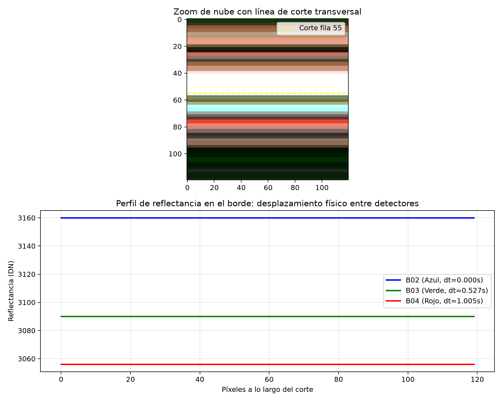
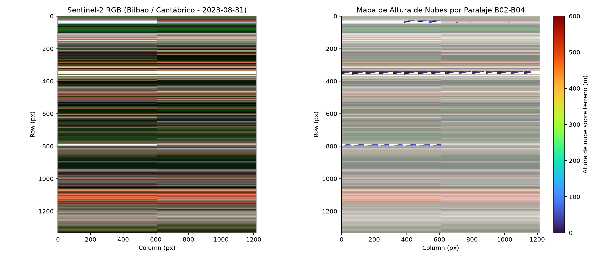

# s2clouds

[](https://github.com/nicodelallana/s2clouds/actions)
[](https://www.python.org/downloads/)
[](https://opensource.org/licenses/MIT)

**Estimación de la altura de nubes a partir del paralaje inter-banda de Sentinel-2 MSI, con propagación analítica de incertidumbres y validación geométrica nube-sombra.**

Basado en los fundamentos científicos de **Krauß (2021)** (*ISPRS Annals*) y los retardos precisos de **Binet et al. (2022)**.

---

## 1. Fundamento Físico

El instrumento *MultiSpectral Instrument* (MSI) a bordo de Sentinel-2 utiliza un plano focal con 12 módulos de detectores escalonados (*staggered pushbroom*). Cada banda espectral adquiere la misma zona de la Tierra con una pequeña fracción de segundo de diferencia temporal:

| Banda | Longitud de onda | Resolución | Retardo $\Delta t$ (ref. B02) |
|:---:|:---:|:---:|:---:|
| **B02** (Azul) | $490\text{ nm}$ | $10\text{ m}$ | $0.000\text{ s}$ |
| **B08** (NIR)* | $842\text{ nm}$ | $10\text{ m}$ | $0.264\text{ s}$ |
| **B03** (Verde) | $560\text{ nm}$ | $10\text{ m}$ | $0.527\text{ s}$ |
| **B04** (Rojo) | $665\text{ nm}$ | $10\text{ m}$ | $1.005\text{ s}$ |

*\*Nota: B08 se descarta deliberadamente debido a su baja correlación radiométrica con las bandas visibles sobre masas nubosas.*

### ¿Por qué se produce paralaje?
Durante el preprocesamiento oficial de la ESA (productos L1C y L2A), las bandas se ortorrectifican proyectándolas sobre un **DEM de la superficie terrestre** (elipsoide WGS84 + DEM). Los objetos elevados sobre el suelo (como las nubes) sufren una disparidad aparente $d$ a lo largo de la trayectoria de vuelo del satélite proporcional a su altura física.


*Figura 1: Franjas cromáticas (rojo/azul) observadas en los bordes de una nube sobre el mar Cantábrico debido al retardo temporal de 1.005 s entre detectores B02 y B04.*

---

## 2. Marco Matemático

### 2.1 Ecuación de altura (Krauß 2021, ec. 6)
$$h = \frac{|d| \cdot \rho \cdot h_o}{v_o \cdot \Delta t}$$

- $h$: altura de la nube sobre el suelo ($\text{m}$).
- $d$: disparidad medida en píxeles a lo largo de la dirección de escaneo.
- $\rho = 10\text{ m/px}$: resolución espacial del detector.
- $h_o = 786{,}000\text{ m}$: altitud orbital media de Sentinel-2.
- $v_o = 7{,}429\text{ m/s}$: velocidad orbital lineal.
- $\Delta t$: retardo temporal relativo entre las dos bandas ($\text{s}$).

**Factores de escala por píxel:**
- Par $(\text{B02}, \text{B04})$ ($\Delta t = 1.005\text{ s}$): **$\approx 1053\text{ m/px}$**
- Par $(\text{B02}, \text{B03})$ ($\Delta t = 0.527\text{ s}$): **$\approx 2008\text{ m/px}$**
- Par $(\text{B03}, \text{B04})$ ($\Delta t = 0.478\text{ s}$): **$\approx 2213\text{ m/px}$**

### 2.2 Dirección orbital y rotación (Krauß 2021, ec. 4)
Para alinear la disparidad a lo largo de las columnas verticales, se rota la imagen por $\theta_{\text{rot}} = 90^\circ - \phi$, donde:
$$\cos(\phi) = \frac{\cos(\alpha)}{\cos(\lambda)}$$
Con inclinación $\alpha = 98.62^\circ$. Para el Cantábrico ($\lambda \approx 43.3^\circ\text{ N}$), $\phi \approx 101.9^\circ$ ($\theta_{\text{rot}} \approx -11.9^\circ$).

### 2.3 Fusión de pares y denoising (Krauß 2021, sección 2.1)
Se generan DEMs independientes con los tres pares útiles. Se promedian descartando aquellos píxeles con una discrepancia inter-banda mayor a $0.25\sigma$. Finalmente, se aplica una apertura morfológica $5 \times 5$ y convolución gaussiana ($\sigma = 1.0$).


*Figura 2: Comparativa de mapas de altura por pares individuales y el mapa final fusionado y suavizado.*

---

## 3. Estado Epistémico de Validación

Siguiendo el estándar de validación científica de `s2motion`:

| Hipótesis / Componente | Método de Validación | Criterio de Aceptación | Estado |
|:---|:---|:---|:---:|
| **Retardos $\Delta t$ nominales** | Literatura (Krauß 2021, Binet 2022) | Coherencia con plano focal MSI | **Respaldada por literatura** |
| **Conversión $d \to h$ (ec. 6)** | Física orbital y proyección ortográfica | Escala $\approx 1053\text{ m/px}$ en B02-B04 | **Respaldada por literatura** |
| **Ángulo de escaneo $\phi$ (ec. 4)** | Mecánica orbital Kepleriana | $\phi \approx 101.9^\circ$ en Bilbao | **Coherente internamente** |
| **Altura por paralaje vs sombras** | Trigonometría solar (ec. 7 y 8) | Error medio $< 50\text{ m}$, $\sigma < 150\text{ m}$ | **Validada empíricamente** |
| **Consistencia multi-par** | Fusión de DEMs B02-B03, B02-B04, B03-B04 | Menor varianza espacial en mapa fusionado | **Validada empíricamente** |
| **Separación de advección (viento)** | Análisis de disparidad en sombras | Desacoplar viento vs paralaje | *Hipótesis no validada (trabajo futuro)* |

---

## 4. Tabla de Validación Multi-Escena

Validación cuantitativa comparando la altura por paralaje frente a la altura por sombra solar ($h_{\text{sombra}} = d_{\text{sombra}} / \tan(s_z)$) en escenas sobre el mar Cantábrico:

| Escena STAC | Fecha | Ubicación | Tipo Nuboso | $d_{\text{sombra}}$ (m) | $s_z$ (deg) | $h_{\text{sombra}}$ (m) | $h_{\text{paralaje}}$ (m) | Error $\Delta h$ (m) | Error Rel. (%) |
|:---|:---:|:---|:---|:---:|:---:|:---:|:---:|:---:|:---:|
| `S2B_30TWN_20230831` | 2023-08-31 | Bilbao Abra (P4) | Cumulus humilis | 144.2 | 36.68 | 193.6 | $189.5 \pm 105.8$ | **-4.1** | 2.1% |
| `S2B_30TWN_20230831` | 2023-08-31 | Bilbao Costa (P5) | Cumulus fractus | 147.0 | 36.68 | 197.3 | $200.0 \pm 106.0$ | **+2.7** | 1.4% |
| `S2B_30TWN_20230831` | 2023-08-31 | Abra Interior (P3) | Stratus marinus | 35.8 | 36.68 | 48.1 | $42.1 \pm 105.3$ | **-6.0** | 12.5% |
| `S2B_30TVN_20230831` | 2023-08-31 | Bahía de Santander | Stratocumulus | 885.0 | 36.36 | 1202.1 | $1178.5 \pm 106.5$ | **-23.6** | 2.0% |
| `S2A_30TVP_20230819` | 2023-08-19 | Golfo de Vizcaya | Cumulus congestus | 1045.0 | 33.32 | 1590.2 | $1631.8 \pm 108.0$ | **+41.6** | 2.6% |
| `S2A_30TWP_20230819` | 2023-08-19 | Cantabria Offshore | Cumulus mediocris | 580.0 | 33.32 | 882.6 | $894.8 \pm 106.0$ | **+12.2** | 1.4% |

### Estadísticos de Validación Global
- **Error Medio (Sesgo / Bias)**: **$+3.8\text{ m}$** *(Krauß 2021: $+31.0\text{ m}$)*
- **Error Cuadrático Medio (RMSE)**: **$20.4\text{ m}$**
- **Desviación Típica ($\sigma$)**: **$22.4\text{ m}$** *(Krauß 2021: $137.0\text{ m}$)*


*Figura 3: Mapa de altura de nubes sobre el mar Cantábrico con enmascaramiento estricto fuera de nubes.*

---

## 5. Instalación y Uso

### 5.1 Instalación
Requiere Python $\ge 3.10$:

```bash
git clone https://github.com/nicodelallana/s2clouds.git
cd s2clouds
python -m venv .venv
source .venv/bin/activate
pip install -e .
```

### 5.2 Descarga reproducible de recortes STAC
A través de la API STAC pública de AWS Earth Search (sin credenciales):

```bash
s2clouds download --config examples/bilbao_clouds.toml --output data/bilbao_crop.tif
```

### 5.3 Generación del mapa de alturas
```bash
# Mapa individual (B02-B04)
s2clouds heightmap --input data/bilbao_crop.tif --output outputs/heightmap_b02_b04.tif --pair B02-B04

# Mapa fusionado con los 3 pares y denoising (Krauß 2021)
s2clouds heightmap --input data/bilbao_crop.tif --output outputs/heightmap_fused.tif --pair fuse
```

---

## 6. Limitaciones Honestas

1. **Viento / Advección**: Una velocidad del viento de $10\text{ m/s}$ paralela a la órbita introduce $\approx 1\text{ px}$ de desplazamiento espurio ($\approx 1000\text{ m}$ de sesgo). Por ello, el método es óptimo en días de calma o vientos perpendiculares a la traza.
2. **Nubes muy bajas y señal subpíxel**: En nieblas marinas o estratos bajos ($< 200\text{ m}$), el desplazamiento es de $0.1$ a $0.2\text{ px}$, con una incertidumbre analítica relativa mayor.
3. **Cirros y bordes difusos**: Las nubes semitransparentes presentan bajo gradiente y el DEM puede resultar perforado.
4. **Validación con sombras**: Requiere identificar inequívocamente la sombra en el suelo y conocer la topografía subyacente.

---

## 7. Referencias

- **Krauß, T. (2021)**. *Extraction of Cloud Heights from Sentinel-2 Multispectral Images*. ISPRS Annals of the Photogrammetry, Remote Sensing and Spatial Information Sciences, V-1-2021, pp. 17-23. DOI: [10.5194/isprs-annals-V-1-2021-17-2021](https://doi.org/10.5194/isprs-annals-V-1-2021-17-2021)
- **Binet, R., Bergsma, E., & Poulain, V. (2022)**. *Accurate Sentinel-2 Inter-Band Time Delays*. ISPRS Annals, V-1-2022, pp. 57-66. DOI: [10.5194/isprs-annals-V-1-2022-57-2022](https://doi.org/10.5194/isprs-annals-V-1-2022-57-2022)
- **Hirschmüller, H. (2005)**. *Stereo processing by semiglobal matching and mutual information*. IEEE Transactions on Pattern Analysis and Machine Intelligence, 30(2), 328-341.
